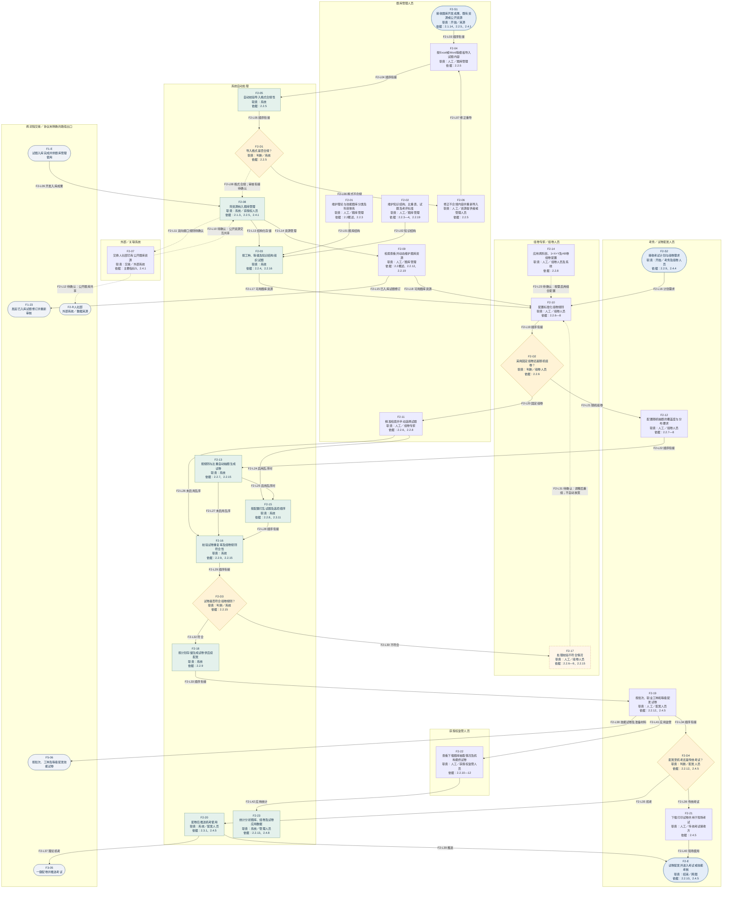
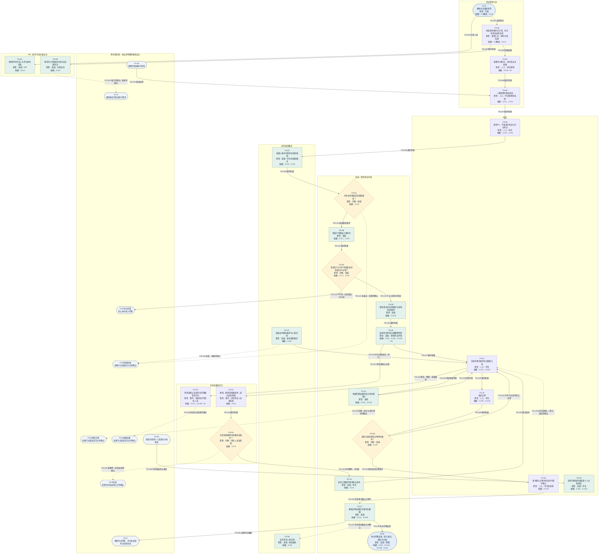
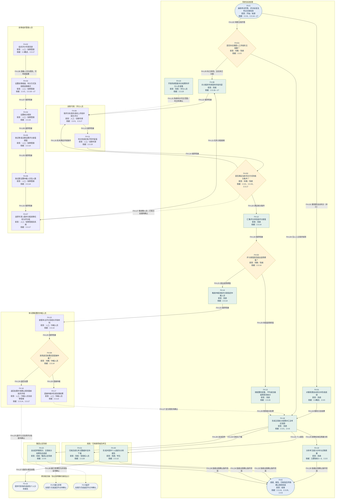
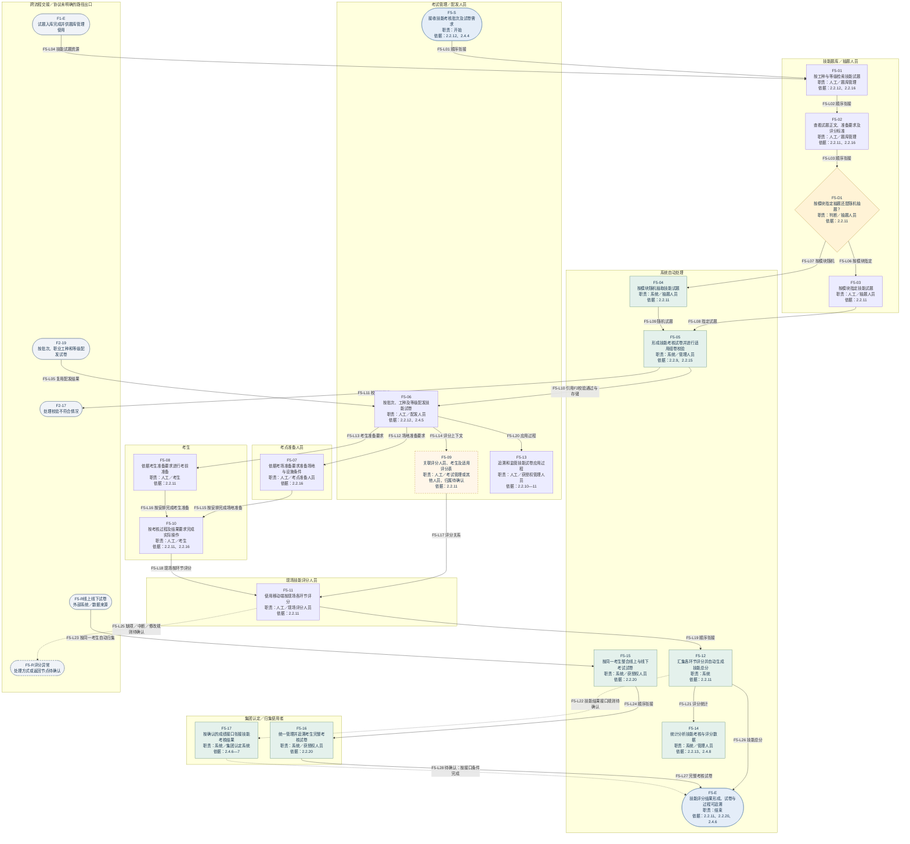
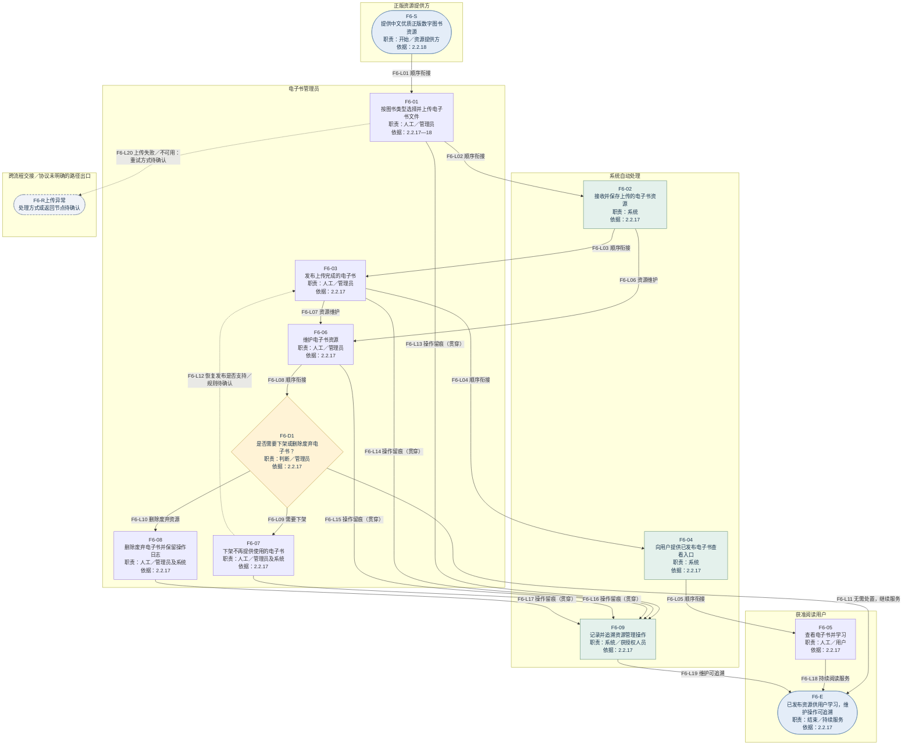

# 六个业务流程 Mermaid 文本

依据已整理的《六个业务流程图完整文字稿》导出。共六图、147个业务节点，保留已有206条流程关系。

使用：复制每个 mermaid 代码块的内部文本到支持 Mermaid 的编辑器；也可直接读取同目录 Mermaid 文件夹中的独立 .mmd 文件。

角色以 subgraph 分组表示。Mermaid 自动布局不保证与 Visio 泳道位置一致；长回路在这里直接用箭头连接。虚线和橙色表示待确认，跨流程节点仅作为交接引用，不重复定义功能。

完整节点说明及输入输出保留在源码的 %% 注释中；控制要求、全部待确认问题及协议追溯详见[完整文字稿](../六个业务流程图完整文字稿.md)。

## F1 题库开发与修订入库

```mermaid
flowchart TB
  %% F1 题库开发与修订入库
  %% 实线：业务衔接；虚线：待确认路径；角色分组不等同于固定岗位或已确认权限。
  subgraph F1_LANE_0["开发组织／管理端"]
    direction TB
    %% F1-S 职责／图形：开始
    %% 说明及输入输出：【编排】包含主动计划、原考务联动产生的试题任务及已入库题目修订需求
    F1_S(["F1-S<br/>接到题库开发或修订需求<br/>职责：开始<br/>依据：2.1.3、2.1.9、2.4.4"])
    %% F1-01 职责／图形：人工／管理端
    %% 说明及输入输出：确定命题范围；理论／技能与三类题库分类在图旁标注
    F1_01["F1-01<br/>维护职业工种、技能等级及多层级科目体系<br/>职责：人工／管理端<br/>依据：2.1概述、2.1.2—3、2.1.12"]
    %% F1-02 职责／图形：人工／管理端
    %% 说明及输入输出：专家基本信息、命题／审核／终审分级权限和任务表现；不等于新增专家资格审批
    F1_02["F1-02<br/>维护专家信息、职责授权及历次任务表现<br/>职责：人工／管理端<br/>依据：2.1.6、2.1.12、2.1.16"]
    %% F1-03 职责／图形：人工／管理端或负责人，归属待确认
    %% 说明及输入输出：依据职业标准或企业评价规范，明确工种、等级及科目范围；不附加计划审批链
    F1_03["F1-03<br/>制定并发布命题计划<br/>职责：人工／管理端或负责人，归属待确认<br/>依据：2.1.3、2.1.13"]
    %% F1-05 职责／图形：人工／获授权任务分配人员
    %% 说明及输入输出：对接专家授权；负责人、各轮处理人和入库人如何分配待确认
    F1_05["F1-05<br/>分配命题与审核任务<br/>职责：人工／获授权任务分配人员<br/>依据：2.1.3、2.1.6、2.1.12—13"]
  end
  subgraph F1_LANE_1["命题负责人"]
    direction TB
    %% F1-06 职责／图形：人工／命题负责人
    %% 说明及输入输出：专家端“项目负责”功能需保留；不得自动赋予全部审批或特批权
    F1_06["F1-06<br/>开展项目负责与命审协作<br/>职责：人工／命题负责人<br/>依据：2.1.13"]
  end
  subgraph F1_LANE_2["命题专家／命审协作"]
    direction TB
    %% F1-07 职责／图形：人工／命题专家
    %% 说明及输入输出：输入本人获分配任务；是否设置接受／拒绝按钮及相应规则待确认
    F1_07["F1-07<br/>在线接收命题或修订任务<br/>职责：人工／命题专家<br/>依据：2.1.4、2.1.13"]
    %% F1-08 职责／图形：人工／命题专家
    %% 说明及输入输出：支持10余种题型；按题型填写题干、选项、答案、解析、评分标准等适用字段
    F1_08["F1-08<br/>选择题型并按标准化模板命制试题<br/>职责：人工／命题专家<br/>依据：2.1.4"]
    %% F1-09 职责／图形：人工／技能命题专家
    %% 说明及输入输出：技能分支补充考生准备、考场准备、考核过程、考核结果要求和评分标准表
    F1_09["F1-09<br/>编制技能试题正文、准备要求及评分标准<br/>职责：人工／技能命题专家<br/>依据：2.1.4、2.2.11、2.2.16"]
    %% F1-10 职责／图形：人工／命审专家
    %% 说明及输入输出：可以在命制和审核阶段发生，不是只进行一次的独立审批
    F1_10["F1-10<br/>在线协作并提出修改意见<br/>职责：人工／命审专家<br/>依据：2.1.5"]
    %% F1-14 职责／图形：人工／命审专家
    %% 说明及输入输出：修改后重新比对；是否强制阻断提交待确认，不预设固定阈值
    F1_14["F1-14<br/>调整优化高度重复试题<br/>职责：人工／命审专家<br/>依据：2.1.7"]
    %% F1-15 职责／图形：人工／命题专家
    %% 说明及输入输出：【编排】衔接命制与协议明确的三轮审核
    F1_15["F1-15<br/>提交试题进入审核<br/>职责：人工／命题专家<br/>依据：2.1.3—4、2.1.8"]
    %% F1-19 职责／图形：人工／命题专家
    %% 说明及输入输出：输出修改后的题目；退回试题数纳入统计；返审规则见F1-Q2
    F1_19["F1-19<br/>根据审核意见修改试题<br/>职责：人工／命题专家<br/>依据：2.1.5、2.1.8、2.1.12"]
    %% F1-23 职责／图形：人工／获授权人员
    %% 说明及输入输出：触发：行业技术更新或政策调整；重新进入命制／修订及审核过程
    F1_23["F1-23<br/>发起已入库试题修订并重新审核<br/>职责：人工／获授权人员<br/>依据：2.1.9、2.1.13"]
  end
  subgraph F1_LANE_3["初审人员"]
    direction TB
    %% F1-16 职责／图形：人工／初审人员
    %% 说明及输入输出：输入待审试题；输出本轮意见及处理结果
    F1_16["F1-16<br/>初审试题并记录审核意见<br/>职责：人工／初审人员<br/>依据：2.1.8、2.1.13"]
    %% F1-D2 职责／图形：判断／初审人员
    %% 说明及输入输出：【编排】置于初审后；不通过后的具体回转节点待确认
    F1_D2{"F1-D2<br/>初审是否通过？<br/>职责：判断／初审人员<br/>依据：2.1.8、2.1.12"}
  end
  subgraph F1_LANE_4["复审人员"]
    direction TB
    %% F1-17 职责／图形：人工／复审人员
    %% 说明及输入输出：同上，属于复审节点
    F1_17["F1-17<br/>复审试题并记录审核意见<br/>职责：人工／复审人员<br/>依据：2.1.8"]
    %% F1-D3 职责／图形：判断／复审人员
    %% 说明及输入输出：【编排】置于复审后；不通过后的具体回转节点待确认
    F1_D3{"F1-D3<br/>复审是否通过？<br/>职责：判断／复审人员<br/>依据：2.1.8、2.1.12"}
  end
  subgraph F1_LANE_5["终审人员"]
    direction TB
    %% F1-18 职责／图形：人工／终审人员
    %% 说明及输入输出：同上，属于终审节点
    F1_18["F1-18<br/>终审试题并记录审核意见<br/>职责：人工／终审人员<br/>依据：2.1.6、2.1.8、2.1.13"]
    %% F1-D4 职责／图形：判断／终审人员
    %% 说明及输入输出：【编排】置于终审后；不通过后的具体回转节点待确认
    F1_D4{"F1-D4<br/>终审是否通过？<br/>职责：判断／终审人员<br/>依据：2.1.8、2.1.12"}
  end
  subgraph F1_LANE_6["特批／入库授权人员"]
    direction TB
    %% F1-X 职责／图形：人工／获授权特批人员
    %% 说明及输入输出：【明确功能、待确认路径】适用条件、处理人、前后节点、是否改变常规流转均待确认
    F1_X["F1-X<br/>处理任务特批<br/>职责：人工／获授权特批人员<br/>依据：2.1.13"]
    %% F1-13 职责／图形：人工或系统，方式待确认
    %% 说明及输入输出：保留“有效剔除”要求；由谁执行、自动或人工、删除还是退出本次任务待确认
    F1_13["F1-13<br/>剔除完全重复试题<br/>职责：人工或系统，方式待确认<br/>依据：2.1.7"]
    %% F1-21 职责／图形：人工／获授权入库人员
    %% 说明及输入输出：输出入库试题及关联记录；与终审是否同人、是否自动入库待确认
    F1_21["F1-21<br/>执行任务入库<br/>职责：人工／获授权入库人员<br/>依据：2.1.3—4、2.1.13"]
  end
  subgraph F1_LANE_7["系统自动处理"]
    direction TB
    %% F1-04 职责／图形：系统
    %% 说明及输入输出：输出匹配结果；匹配依据、是否允许人工调整待确认
    F1_04["F1-04<br/>智能匹配专家资源<br/>职责：系统<br/>依据：2.1.3"]
    %% F1-11 职责／图形：系统
    %% 说明及输入输出：将意见汇总供命审人员处理，保留关联对象
    F1_11["F1-11<br/>汇总修改意见与协作记录<br/>职责：系统<br/>依据：2.1.5、2.1.8、2.1.10"]
    %% F1-12 职责／图形：系统
    %% 说明及输入输出：输入待处理试题与对比范围内试题；输出重复比例和比对结果，具体算法及范围待确认
    F1_12["F1-12<br/>比对试题内容并给出重复性比例<br/>职责：系统<br/>依据：2.1.7"]
    %% F1-D1 职责／图形：判断／系统及人员
    %% 说明及输入输出：【编排】完全重复／高度重复／其他；高度重复阈值待确认
    F1_D1{"F1-D1<br/>重复性结果属于哪一类？<br/>职责：判断／系统及人员<br/>依据：2.1.7"}
    %% F1-20 职责／图形：系统／获授权人员
    %% 说明及输入输出：记录修改人、修改时间、修改内容，衔接审核与入库；版本粒度和编号规则待确认
    F1_20["F1-20<br/>维护试题版本及修改记录<br/>职责：系统／获授权人员<br/>依据：2.1.3、2.1.8—10"]
  end
  subgraph F1_LANE_8["关联系统"]
    direction TB
    %% F1-22 职责／图形：系统／关联系统
    %% 说明及输入输出：与集团认定系统同步管理，向F2提供试题资源；主数据和同步方向按接口确认
    F1_22["F1-22<br/>同步命审专家及试题资源<br/>职责：系统／关联系统<br/>依据：2.1.14、2.4.7"]
    %% F1-E 职责／图形：结束／跨图
    %% 说明及输入输出：【编排】单次开发任务结果交给F2；后续可循环修订
    F1_E(["F1-E<br/>试题入库完成并供题库管理使用<br/>职责：结束／跨图<br/>依据：2.1.3、2.1.14"])
  end
  subgraph F1_LINKS["跨流程交接／协议未明确的路径出口"]
    F1_R任务(["F1-R任务<br/>处理方式或返回节点待确认"])
    F1_R审核(["F1-R审核<br/>处理方式或返回节点待确认"])
  end
  F1_S -->|"F1-L01 顺序衔接"| F1_01
  F1_01 -->|"F1-L02 顺序衔接"| F1_02
  F1_02 -->|"F1-L03 顺序衔接"| F1_03
  F1_03 -->|"F1-L04 顺序衔接"| F1_04
  F1_04 -->|"F1-L05 顺序衔接"| F1_05
  F1_05 -->|"F1-L06 顺序衔接"| F1_07
  F1_07 -->|"F1-L07 顺序衔接"| F1_08
  F1_01 -.->|"F1-L08 待确认：基础资料已有可复用"| F1_03
  F1_06 -.->|"F1-L09 项目协作，分工待确认"| F1_03
  F1_06 -.->|"F1-L10 待确认：协作"| F1_05
  F1_08 -->|"F1-L11 技能试题"| F1_09
  F1_08 -->|"F1-L12 理论试题"| F1_12
  F1_09 -->|"F1-L13 技能内容就绪"| F1_12
  F1_10 -->|"F1-L14 意见汇总与完善"| F1_11
  F1_11 -->|"F1-L15 顺序衔接"| F1_08
  F1_11 -->|"F1-L16 完善技能内容"| F1_09
  F1_12 -->|"F1-L17 顺序衔接"| F1_D1
  F1_D1 -.->|"F1-L18 完全重复；处置方式待确认"| F1_13
  F1_D1 -->|"F1-L19 高度重复"| F1_14
  F1_14 -->|"F1-L20 调整后重新比对"| F1_12
  F1_D1 -.->|"F1-L21 待确认：按确认规则可提交"| F1_15
  F1_15 -->|"F1-L22 顺序衔接"| F1_16
  F1_16 -->|"F1-L23 顺序衔接"| F1_D2
  F1_D2 -->|"F1-L24 初审通过"| F1_17
  F1_17 -->|"F1-L25 顺序衔接"| F1_D3
  F1_D3 -->|"F1-L26 复审通过"| F1_18
  F1_18 -->|"F1-L27 顺序衔接"| F1_D4
  F1_D2 -.->|"F1-L28 待确认：需修改／退回"| F1_19
  F1_D3 -.->|"F1-L29 待确认：需修改／退回"| F1_19
  F1_D4 -.->|"F1-L30 待确认：需修改／退回"| F1_19
  F1_19 -->|"F1-L31 修改留痕"| F1_20
  F1_20 -.->|"F1-L32 修改后返审；入口待确认"| F1_R审核
  F1_D4 -->|"F1-L33 终审通过"| F1_20
  F1_20 -->|"F1-L34 终审通过后的版本入库"| F1_21
  F1_21 -->|"F1-L35 顺序衔接"| F1_22
  F1_22 -->|"F1-L36 顺序衔接"| F1_E
  F1_E -->|"F1-L37 技术／政策变化"| F1_23
  F1_23 -.->|"F1-L38 待确认：重新修订审核"| F1_07
  F1_X -.->|"F1-L39 特批触发与返回节点待确认"| F1_R任务
  classDef system fill:#e4f1ec,stroke:#56866e,color:#19324b;
  classDef decision fill:#fff3d6,stroke:#b58b31,color:#19324b;
  classDef terminal fill:#e4edf8,stroke:#6489b0,color:#19324b;
  classDef external fill:#f0f3f8,stroke:#8292a8,color:#19324b;
  classDef pending fill:#fff6e9,stroke:#b88332,stroke-dasharray:5 4,color:#19324b;
  class F1_04,F1_11,F1_12,F1_20,F1_22 system;
  class F1_D2,F1_D3,F1_D4,F1_D1 decision;
  class F1_S,F1_E terminal;
  class F1_03,F1_X,F1_13,F1_R任务,F1_R审核 pending;
  class F1_R任务,F1_R审核 external;
```

## F2 题库资源管理、组卷校验与试卷配发

## F3 无纸化理论考试组织、核验、作答与交卷

## F4 客观判分、主观阅卷、差值仲裁与成绩处理

## F5 操作技能试卷配发、现场评分与试卷归集

## F6 电子书资源上传、发布、阅读与维护

