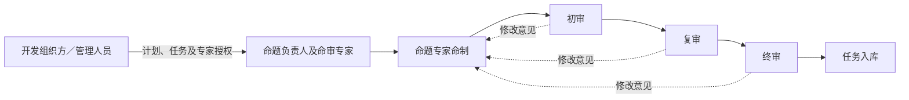
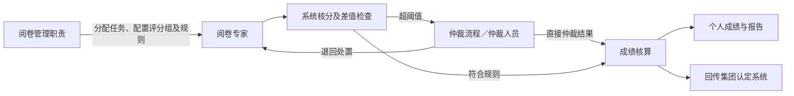

# 系统角色专题

本专题依据《技术协议（招标文件）.docx》梳理系统使用角色、职责及相互关系，供需求和权限设计核对使用。记录日期：2026-09-21。

协议没有给出完整的角色目录，角色信息分散在管理端、专家端、题库管理、考试、阅卷、现场评分及系统对接条款中。不能仅概括为“管理员、专家、考生”，也不能将每项功能自动扩展为一个必须新增的岗位、账号或独立客户端。

## 一、角色识别口径

- **明确角色**：协议直接提及的使用者或职责身份。
- **流程角色**：协议明确规定流程节点，按该节点梳理出的职责身份；不等于必须设置独立岗位。
- **功能归纳角色**：协议明确要求功能，但没有命名操作人员。本专题采用工作名称，便于讨论权限归属，不增加功能。
- **关联人员或组织**：协议提及其参与业务或对接，但未明确其在本系统中的直接操作权限。

角色表示承担什么职责，人员表示实际使用者，机构表示所属组织，任务分配表示在某次业务中负责哪些对象。四者不能混为一谈。以下清单不构成固定数量的账号角色要求。

## 二、角色及职责清单

| 业务环节 | 角色或职责身份 | 依据及性质 | 协议支持的职责与边界 |
| --- | --- | --- | --- |
| 题库开发组织 | 题库开发组织方／开发管理人员 | 2.1.10明确组织方；2.1.3、2.1.6、2.1.11—12规定管理端功能 | 组织方跟踪任务进度；管理端管理科目、计划、任务、专家和授权，统计专家表现及计划成果。组织方是组织主体，具体由哪些人员操作需落实，不能默认所有功能归同一个管理员。 |
| 题库开发负责 | 命题负责人 | 2.1.13明确角色 | 在专家端参与开发修订任务和项目负责等业务。协议同时列出任务特批、终审任务、任务入库等功能，但没有将这些权限逐项授予命题负责人。 |
| 试题命制 | 命题专家 | 2.1.4—6、2.1.13明确角色 | 接收命题任务，按模板命制试题，参与线上协作与修订；由专家授权和任务安排确定工作范围。 |
| 试题初审 | 初审人员 | 2.1.8流程角色；2.1.13明确审题专家 | 承担初审节点，提出审核意见，保留该轮操作记录。属于审题职责的阶段划分。 |
| 试题复审 | 复审人员 | 2.1.8流程角色；2.1.13明确审题专家 | 承担复审节点并留痕。协议要求存在复审环节，但未规定必须新增独立专家类别或由不同自然人承担。 |
| 试题终审 | 终审人员／终审专家 | 2.1.6明确终审角色；2.1.8、2.1.13明确终审节点和功能 | 承担终审职责。终审与执行入库是可区分的操作，不能直接认定终审人员必然拥有入库或特批权限。 |
| 题库资源管理 | 题库管理人员 | 2.2.3—5、2.2.12—14、2.2.16、2.2.19，功能归纳角色 | 对科目、知识结构、比重表、试题等进行管理，执行导入、维护及协议规定的资源操作。具体权限归属未明示。 |
| 组卷 | 组卷专家／组卷操作人员 | 2.2.8明确专家自定义组卷；2.2.6—9、2.2.15规定组卷功能 | 专家选题、设置题型分值及难度等，形成试卷；固定和随机组卷的配置、执行权限需分配给相应操作人员。协议未要求单独建立“组卷专家库”。 |
| 配卷及考试组织 | 考试管理人员／考务人员 | 2.3概述、2.3.1明确管理人员；2.2.12、2.4.4—5规定配发和考务联动 | 组织考试、配卷推送，衔接考试计划、考点考场及机考／传统考试配发。与原考务系统的操作分工需落实，不能自行复制建设全部原考务功能。 |
| 阅卷组织管理 | 阅卷管理人员 | 2.3.18明确管理人员；2.3.14—17规定管理配置，按职责归纳名称 | 对阅卷过程进行监控与追溯；分配专家、配置评分组、核分规则和仲裁等操作的具体授权需落实。未要求设置专职岗位。 |
| 主观题阅卷 | 阅卷专家／评分人员 | 2.3.5、2.3.17—19明确角色 | 承担被分配的线上判卷任务，支持一判、双判、多判，查看系统开放的判分结果，并进行阅卷电子签字。 |
| 评分仲裁 | 仲裁人员 | 2.3.14明确角色 | 针对评分差值超阈值的事项参与仲裁；支持按试题设置仲裁人员及人数，流程支持退回处置或直接仲裁。具体操作权限需随流程确定。 |
| 实操评分 | 现场技能评分人员（工作名称） | 2.2.11明确移动评分功能，功能归纳角色 | 对实际操作考试各环节现场评分，系统汇总技能总分。不能仅因使用移动端就归入考生角色；该条没有明确要求现场评分签字。 |
| 考试作答 | 考生 | 2.3.1—13、2.2.20明确角色 | 身份核验，使用PC、平板或手机考试，作答、续考、交卷及签字确认，查看个人成绩和分析报告；同一考生的线上线下考核试卷整合归集。终端类型不构成不同角色。 |
| 电子书维护 | 电子书管理员 | 2.2.17明确管理员，按业务命名 | 按类型上传、发布电子书，下架或删除废弃资源并保留日志。不能据此推定其拥有全部系统管理权限。 |
| 电子书阅读 | 电子书使用者／学习用户 | 2.2.17明确用户查看学习，按业务命名 | 查看已发布电子书。是否仅限考生、是否包含其他员工，协议未明确；没有独立学习平台或学习考核要求。 |
| 业务统计与追溯 | 业务管理及监管使用者 | 2.1.10—12、2.2.10、2.2.13、2.3.18、2.4.8，功能归纳角色 | 按职责使用进度、绩效、试卷使用、考试阅卷及多维统计结果。可以由既有管理角色承担，协议未单独设立领导端、监管员或数据分析师岗位。 |

“命审专家”是命题专家和审题专家的集合称谓，不宜再自动增加一个与命题、审核平行且权限全开的角色。“评分专家”“阅卷专家”“评分人员”在无纸化考试上下文中存在称谓交叉，应结合具体任务识别，不能仅按名称重复建角色。

## 三、相关人员及组织的边界

| 对象 | 协议依据 | 对角色设计的结论 |
| --- | --- | --- |
| 监考人员 | 2.4.4提及监考人员分配；2.3概述包含过程监控 | 是明确的考务参与者，但协议没有单独规定监考端及其操作清单。不能自行赋予换机审批、延时、强制交卷或人工作弊裁定权限。 |
| 考点／考场工作人员 | 2.2.16要求辅助考点准备考场；2.3概述涉及考点考场分配 | 考点是业务组织对象，准备人员的直接登录和操作权限未明确；不能据此新增考点管理员或考场负责人工作台。 |
| 集团管理部门与各考试机构 | 主要指标4、2.2.10、2.2.13、2.4.7—8 | 体现集团与机构的业务层次，不能直接推出固定的集团—机构多级审批链，或默认每个机构都有独立管理员。具体组织权限需对应实际管理职责。 |
| 系统管理与运维人员 | 2.1.16、2.2.14规定权限控制；实施交付要求含管理员手册，9.5规定甲方编译、测试、部署 | 存在管理维护需要，但协议未列完整系统管理员权限表。不得把业务管理员等同于拥有全部数据权限的超级管理员。 |
| 人社部、HR、OA、原考务及认定系统 | 2.4.1—9 | 是对接系统或业务主体，不是本系统中的人工角色；接口身份与人工用户权限应区别梳理。 |
| 项目经理、开发、测试、实施及验收人员 | 第六至第九部分 | 属于项目交付参与者，不自动成为上线系统的业务角色。9.6规定乙方人员不得接触甲方真实数据，不能默认授予生产数据访问权。 |

## 四、角色之间的业务关系

### 1. 题库开发关系

题库开发组织方通过管理端组织计划、任务及专家授权；命题负责人在专家端参与项目负责；命题专家承担试题命制；审题人员依次承担初审、复审、终审；审核、修订及入库形成可追溯过程。

图中表示业务衔接，不代表新增审批规则。修改后回到哪一轮、由谁执行任务特批和入库，协议未逐项明确。命题负责人是业务职责，不等同于第七部分乙方项目经理，也不能默认是全部专家的行政上级。

理论开发与技能开发均适用这套职责分类。依据2.1.1，两者须支持独立部署与协同运行；不能因此推定必须建立两套完全独立的人员库，也不能假设获得理论开发权限就自动获得技能开发权限，具体授权映射需在部署及权限方案中落实。

### 2. 题库资源到考试的关系

题库管理人员维护资源，组卷专家／组卷操作人员依据规则形成试卷，考试管理人员完成配发和考试推送，考生参加考试。协议同时支持机考与传统考试配发；实操评分人员按现场环节评分，系统汇总技能总分并支持考生线上线下试卷归集。

其中，资源维护、选题组卷、试卷配发、现场评分是不同的职责，并不因都能接触试题就自动拥有彼此权限。2.2.10规定的抽取情况和最终试卷查看下载属于受控业务能力，其具体使用者须明确，不能默认为所有专家可用。

### 3. 阅卷与仲裁的关系

阅卷组织方配置核分规则、专家任务及评分组等；阅卷专家完成判分；评分差值超出设定阈值时触发仲裁流程，由配置的仲裁人员参与处理；系统按配置核算结果。管理人员监控进度、质量和效率，成绩按2.4.6回传集团认定系统。

一判、双判、多判描述任务分配和判分方式，并非三种固定人员身份。评分组是专家组织单元，协议没有明确“评分组长”这一独立角色。仲裁职责与普通判分职责需区分，但是否允许同一人员兼任、是否需要回避，由适用制度及详细需求确定，不能在本专题中新增限制。

2.3.16支持选择保密阅卷模式并屏蔽考生身份，不等于所有阅卷场景一律匿名。2.3.13的交卷后成绩报告与2.3.5的主观题人工阅卷需要在显示时点上衔接；协议未要求增加成绩审批角色。

### 4. 电子书与管理分析关系

电子书管理员发布和维护资源，学习用户查看已发布内容。这条关系不能直接合并为“考生才可阅读”。各业务管理人员使用其职责范围内的统计、追溯结果；查看统计报表不应被解释为协议授予其全部命题、评分或资源维护权。

## 五、权限落地时需要明确的关系

以下为协议已有功能的归属问题，不是新增功能清单：

| 待明确事项 | 协议已明确的内容 | 尚未明确的内容 |
| --- | --- | --- |
| 负责人和开发管理人员分工 | 管理端统一管理；专家端包含项目负责等功能 | 计划发布、任务调整、特批和入库分别由谁执行 |
| 审核轮次及兼任 | 初审、复审、终审与分级授权 | 各轮是否必须不同人员，命题与审题兼任／回避规则 |
| 题库与组卷配卷权限 | 维护、组卷、配发、下载和追溯功能 | 各机构和具体人员的资源范围、下载范围及角色组合 |
| 考务和监考操作 | 原考务联动、监考安排、过程监控、断点续考 | 哪些操作在原系统完成，哪些在新系统完成，监考是否直接登录及其权限 |
| 阅卷与仲裁配置 | 专家分配、评分组、核分规则和仲裁人员配置 | 哪类管理人员负责各项配置，以及阅卷与仲裁兼任关系 |
| 现场评分权限 | 移动评分、环节评分及总分汇总 | 评分任务如何对应人员和考生，是否由现有阅卷专家兼任 |
| 阅读及统计范围 | 电子书查看、多维统计与业务追溯 | 学习用户范围、机构和人员可以查看的数据范围 |
| 技术管理身份 | 权限控制、安全保密测评及管理运维需要 | 系统、安全、审计等管理职责如何依适用要求配置；不能仅凭泛化安全条款认定具体账号体系 |

应以角色、业务对象及任务关系共同描述授权：例如，同为审题专家，仍要确定其承担的审核轮次和任务；同为阅卷专家，仍要确定所分配的试题、考生或试卷；同为仲裁人员，仍要对应被配置的试题。具体权限矩阵需据协议和甲方制度落实，不在此擅自增加岗位、审批节点或客户端。

## 六、对现有角色总结的修正

现有《职业技能等级认定系统_功能清单与产品技术架构_V0.1.docx》的“角色权限与业务闭环”将若干职责合并概括，适合总览，但不足以直接作为详细权限设计依据：

1. “项目负责人／命题专家”应区分命题负责与实际命制职责，且不能与乙方项目经理混同。
2. “题库／组卷管理员”应区分资源管理、专家组卷及配卷职责；协议明确提到专家自定义组卷。
3. “考务／监考人员”应区分考试管理操作和监考安排，不能将所有考务及应急操作默认授予监考人员。
4. “阅卷／仲裁专家”应区分普通判分与超阈值仲裁职责，并补充阅卷组织管理关系。
5. “考生／授权学习用户”应区分考试与电子书阅读身份，并补充电子书管理员。
6. 现场技能评分属于协议已有功能，应保留独立职责说明；原总结中的现场评分“签字”不能据2.3.19直接扩展，后者明确的是阅卷专家电子签字。
7. “集团／机构管理员”属于组织与管理职责的归纳，不能直接视为协议规定的固定角色目录或审批层级。
8. 系统管理员、安全和审计等技术管理身份，与业务角色分开讨论；安全测评要求仍须满足，但具体角色体系不能无依据地定为协议原文要求。

本专题完成角色识别和关系梳理，未修改现有代码、权限配置或原Word文档，也不表示待明确事项已经确认。
